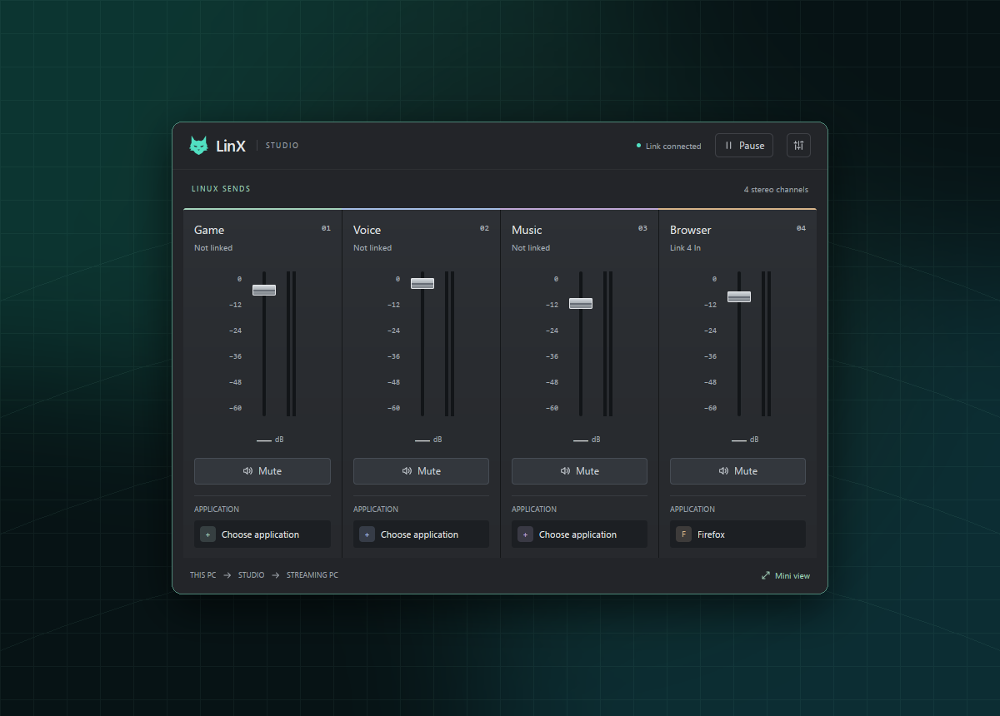
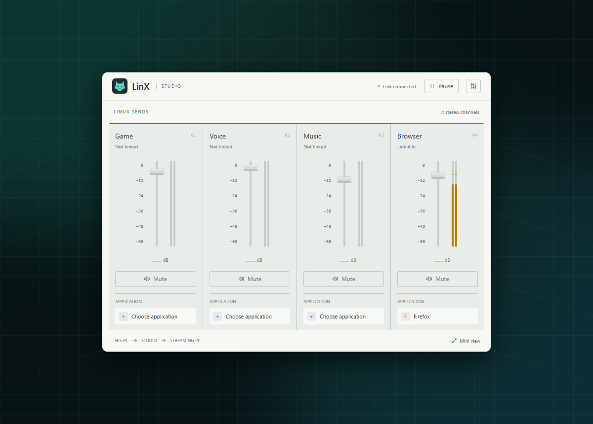

# LinX

### Unofficial BEACN Link app for Linux

LinX is an independent Linux desktop app that does what BEACN Link does on
Windows: it gives the gaming PC four Link In channels on BEACN Studio, and
sends applications to them. BEACN App on the Windows streaming PC sees each
application and its channel, and can move it.

LinX is **unofficial and not affiliated with BEACN**. It is experimental
compatibility software, not a BEACN product or a replacement for BEACN App on
Windows.



<details>
<summary>Light theme</summary>



</details>

## What works today

- Four persistent channels, **LinX Link In 1–4**, bridged to the Studio's Link
  In pairs at 96 kHz. They also appear in your desktop sound settings.
- Any number of applications, each on any channel. Moving an application
  between channels is a single redirect; nothing is torn down.
- Applications keep their channel through media pause/resume, new browser
  tabs, application restarts and PipeWire/WirePlumber restarts.
- Other applications, notifications, default-device changes and capture tools
  (such as OBS application audio) do not disturb the links.
- Application names are published to BEACN App, and assignments made there
  move the application.
- Live stereo levels for every channel, plus working faders and mute that set
  what this PC sends on each Link In. They stay in sync with the channel's
  volume in your desktop sound settings.
- Closing the window keeps LinX running in the system tray (or minimized,
  on desktops without a tray). Pause or Quit returns every application to the
  output it used before.
- Light and dark themes, with five accent palettes.

Hardware status: the new channel engine has passed software checks on
Debian 13 with PipeWire 1.4.2 and the actual GUI. It still needs testing with
the Studio attached (audio on each channel, BEACN App names and remote
assignment, unplug/replug). See [Link Console](docs/link-console.md).

## Current limits

Faders, mute and meters act on what this PC sends. LinX does not control
the streaming PC's mix.
There is no installer or launch-at-login yet, and no Windows version.
Distributions whose BEACN UCM profile splits the Studio into separate Link
outputs (alsa-ucm-conf 1.2.15 and later) are untested.

## Try it

This is a development build path, not an installer. Use a Linux desktop with
PipeWire and WirePlumber, connect BEACN Studio to the Linux PC, and run
BEACN App on the Windows streaming PC. The GPUI app uses the Rust 1.99.0
toolchain pinned in `app-gpui/rust-toolchain.toml`. The native build needs
PipeWire/SPA development headers 1.0 or newer and libusb 1.0.27 or newer; see
the [PipeWire build notes](docs/native-executor.md) and
[USB requirements](docs/native-usb-handshake.md).

```sh
cd app-gpui
cargo run --features studio -- --studio
```

Click a channel's application box, then pick 1–4 next to an application.
**Off** returns it to its previous output. You can also choose
"LinX Link In N" as an application's output in your desktop sound settings.
Audio works as is. For the BEACN App connection (names and remote
assignment), your desktop account needs access to the Studio's USB device; if
LinX reports the BEACN App link as unavailable, install
[`integrations/udev/70-linx-beacn-studio.rules`](integrations/udev/70-linx-beacn-studio.rules)
to `/etc/udev/rules.d/` and replug the Studio.

## Screenshots

The screenshot is taken from LinX's own native window and framed with the
standalone [screenshot helper](scripts/frame_screenshot.py). See
[the screenshot guide](docs/screenshots.md) for capture and review steps.

## Project status and license

Copyright © 2026 LinX contributors.

LinX is licensed under [GNU GPL version 3 only](LICENSE). Third-party
components retain their respective copyright and license notices.

LinX is an independent working name, not a trademark-clearance result. BEACN
and BEACN Link are referenced only to identify the compatibility target.

## Further reading

- [Link Console design and evidence](docs/link-console.md)
- [Current handoff and runtime evidence](docs/HANDOFF.md)
- [Contributing](CONTRIBUTING.md)
- [Release preparation](docs/releasing.md)
- [Native GPUI interface](docs/gpui-interface.md)
- [Native desktop session](docs/native-desktop-session.md)
- [Native meter behavior and evidence](docs/native-meters.md)
- [Protocol and compatibility research](docs/protocol.md)
- [Phased research plan](docs/research-plan.md)
